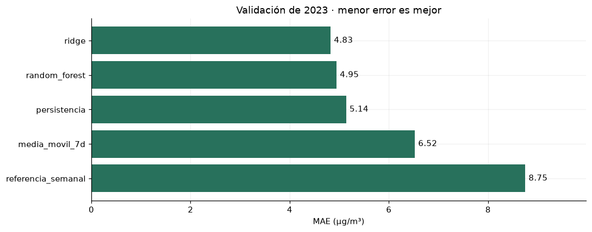
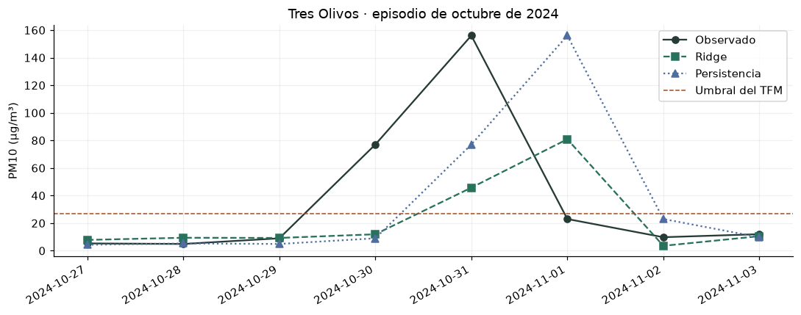
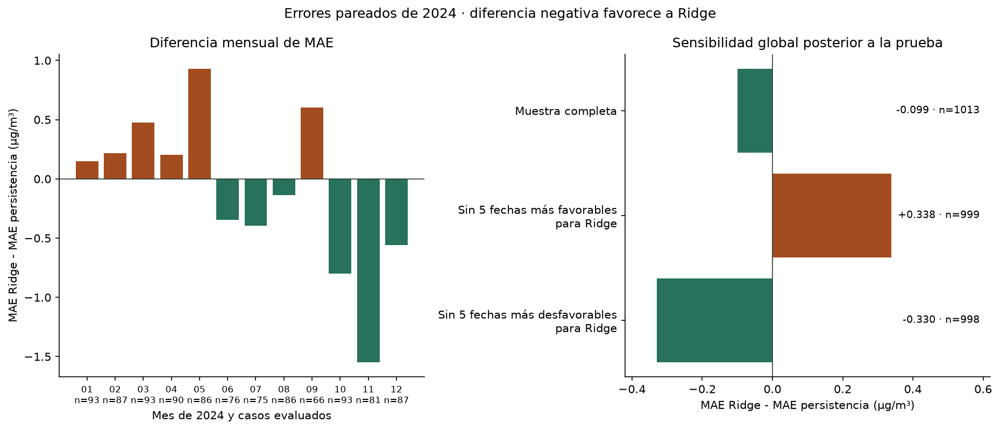
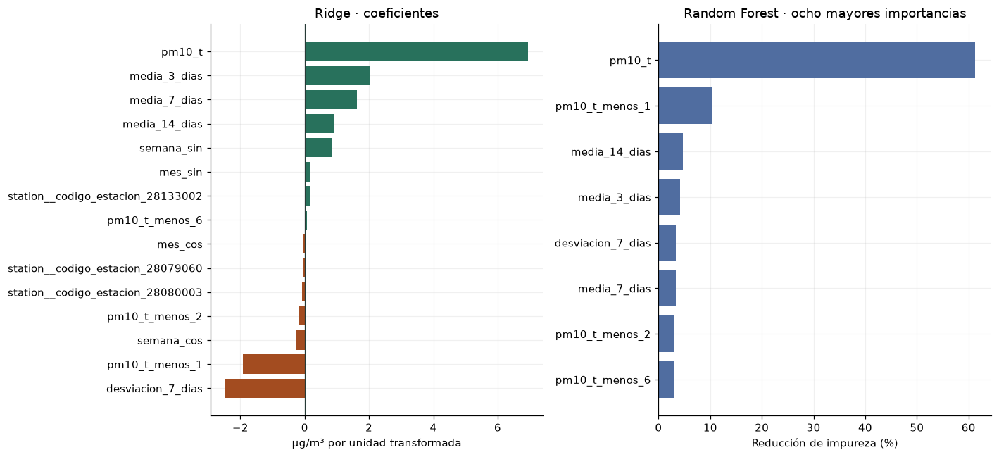
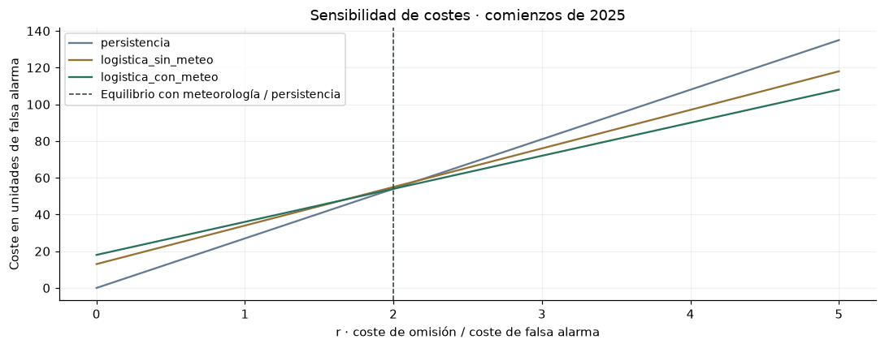

# Predicción de PM10 en Madrid y Barcelona provincia

Este proyecto predice la concentración de PM10 del día siguiente en tres estaciones de Madrid y tres de Barcelona provincia. Incluye un explorador interactivo para consultar las mediciones, comparar las predicciones y examinar los resultados por estación y fecha. En Madrid también se evalúa si la previsión de viento y precipitación ayuda a anticipar el comienzo de días con PM10 elevado.

El trabajo comenzó explorando el cruce de contaminación y altas hospitalarias. La cobertura y la escala anual del panel sanitario llevaron a concentrar el núcleo predictivo en las mediciones diarias de PM10. El análisis sanitario provincial permanece como complemento exploratorio.

Ridge obtuvo una mejora modesta del error global frente a persistencia en la prueba de 2024. En los días elevados, persistencia tuvo menor MAE. En clasificación de 2025, añadir viento y precipitación previstos permitió detectar tres comienzos adicionales frente a la logística base y produjo más falsas alarmas. Estos resultados motivan analizar cobertura, errores y utilidad junto con las métricas globales.

## Problema y decisión propuesta

La [réplica de Barcelona provincia](docs/38_experimentos_madrid_barcelona.md) amplía la regresión a Rubí, Sant Celoni y Sant Vicenç dels Horts, con el mismo calendario y la misma especificación de Ridge. En 2024 reduce el MAE frente a persistencia un 10,61 % sobre 801 casos. La mejora en Madrid es del 1,64 % sobre 1.013 casos. La sensibilidad con 78 fechas completas compartidas reduce la diferencia entre mejoras al 3,84 % y 6,42 %. React permite alternar ambos experimentos y las dos bases de comparación. La composición de estaciones y la cobertura difieren; los resultados originales de Madrid se conservan.

La primera pregunta es cuánto PM10 medio se observará en el siguiente día, expresado en µg/m³. Se formula como regresión con variables temporales. La segunda pregunta es si ese día superará 27 µg/m³, el percentil 90 de los objetivos disponibles del entrenamiento original.

Un comienzo se produce cuando una estación pasa de un día con PM10 de hasta 27 µg/m³ a otro estrictamente por encima. Un aviso activaría una revisión anticipada de la programación y la preparación de alternativas. Su utilidad depende del coste de revisar innecesariamente una actividad y del coste de reaccionar tarde a un comienzo.

La definición de día elevado se basa en la muestra de entrenamiento del proyecto. Las decisiones operativas requerirían acordar criterios con la organización y comprobar la disponibilidad real de los datos. [Protocolo y planteamiento](docs/11_enfoques_y_evaluacion.md) · [Caso de uso y costes relativos](docs/30_metricas_negocio_pm10.md)

## Datos y procedencia

| Fuente | Información utilizada | Función |
| --- | --- | --- |
| MITECO | PM10 diario y horario y metadatos de estaciones | Histórico de 2017–2024, controles de calidad y selección de estaciones. |
| Agencia Europea de Medio Ambiente (EEA) | PM10 horario verificado de los mismos puntos | Observado de 2025 y contraste con MITECO en 2024. |
| NOAA GFS | Viento a 10 m y precipitación previstos | Comparación de clasificación con y sin meteorología. |
| INE | Altas hospitalarias y población por edad | Complemento sanitario provincial y anual. |

El núcleo diario utiliza Tres Olivos (28079060), Majadahonda (28080003) y San Martín de Valdeiglesias (28133002). La tabla contiene 8.766 observaciones de estación y fecha entre 2017 y 2024. Los originales se conservan junto a sus manifiestos y huellas.

Los inventarios documentan URL, método, formato, columnas y tipos. Las fuentes incluyen CSV, ZIP con tablas, Excel, Parquet y fragmentos GRIB2. La API local sirve los valores al navegador en JSON. [Fuentes y formatos](docs/15_fuentes_endpoints_formatos.md) · [Inventario de descargas](docs/reference/source_endpoints.md) · [Esquemas originales](docs/reference/source_schemas.md)

## Preparación y dificultades resueltas

La [permutación agrupada en validación de 2023](docs/42_importancia_agrupada_pm10.md) interpreta los Ridge originales de ambos territorios. Alterar PM10 reciente y retardos aumenta el MAE medio 1,924 µg/m³ en Madrid y 1,721 en Barcelona. Las medias, la variabilidad y el calendario también se estudian, junto con una sensibilidad del historial completo. El método conserva secuencias circulares dentro de estación y documenta sus combinaciones artificiales; los rangos entre alteraciones no son intervalos de confianza ni efectos causales. Se consulta en React sin reajustar modelos.

La [comparación exploratoria de ventanas](docs/41_comparacion_ventanas_pm10.md) retira únicamente la media de 14 días y separa el efecto de la variable del cambio de entrenamiento. En validación de 2023, Barcelona gana 90 casos evaluables y Madrid 23. Manteniendo las filas de entrenamiento y evaluación, el MAE aumenta 0,016 y 0,022 µg/m³ respectivamente. React separa las cohortes comunes, adicionales y ampliadas; los modelos y resultados originales de 2024 se conservan.

El diagrama de caja de Estadísticas permite elegir una columna y comparar estaciones sobre todas las filas filtradas. Muestra cuartiles, mediana, media, bigotes y valores exteriores sin eliminarlos. Los 185 casos de columna y grupo de las tablas tratadas se contrastaron con el cálculo de boxplot de Matplotlib, que solo se utiliza para verificación.

Las tablas tratadas incorporan una pestaña de [estadísticas descriptivas](docs/40_estadisticas_descriptivas.md). Una función reutilizable con biblioteca estándar calcula extremos, cuartiles, media, mediana, desviación y ausencias sobre todas las filas filtradas, excluyendo identificadores y claves. Sus resultados se contrastaron con pandas para las 79 columnas numéricas de las siete tablas y se verificaron también en Docker.

La [auditoría territorial de cobertura](docs/39_auditoria_cobertura_territorial.md) identifica 297 días-estación excluidos en Barcelona: 40 sin objetivo y 257 con objetivo observado e historial incompleto. Quedan fuera 46 de 191 días elevados observados. La media de 14 días es la única variable ausente en 118 filas con objetivo conocido. React permite revisar las causas, meses, estaciones y fechas que originan las ausencias. El diagnóstico conserva los modelos y las predicciones existentes.

Los lectores interpretan el formato de origen y los mapeadores normalizan fechas, códigos, unidades y valores. Se conservan las referencias al archivo y al registro para auditar las transformaciones. En sanidad se mantiene el nivel geográfico y se asignan códigos territoriales antes de unir las tablas. [Mapeadores y tablas](docs/16_trazabilidad_mappers_tablas.md)

En PM10, el calendario conserva los días sin medición válida. Las ventanas exigen observaciones completas y las filas incompletas quedan fuera del conjunto común de evaluación. La auditoría distingue huecos de cobertura y picos, revisa su procedencia y permite conservar episodios válidos. Un hueco puede afectar a varias filas posteriores por su presencia en ventanas móviles. [Auditoría de huecos y picos](docs/17_auditoria_huecos_y_picos_pm10.md)

Las entradas iniciales son el PM10 previo y sus retardos, medias de 3, 7 y 14 días, desviación de 7 días, calendario semanal y mensual y estación. Las ventanas terminan en la última observación. Seno y coseno codifican los ciclos del calendario y la estación se representa mediante indicadores. [Tabla predictiva y referencias](docs/12_tabla_predictiva_y_referencias.md)

Para la prueba de 2025 se construyeron medias de horas verificadas de la EEA, con al menos 18 horas válidas por día UTC. La conversión de sus marcas UTC+1 fijo y la alineación de puntos permitieron contrastar exactamente 25.969 valores horarios válidos de 2024 con MITECO. En 2017–2024 se priorizaba el valor diario oficial y en 2025 se utilizaron medias horarias, una diferencia que acompaña la interpretación. [Preparación y contraste de 2025](docs/25_prueba_meteorologia_2025.md)

La meteorología se obtuvo de campos de GFS mediante rangos de bytes. Se conservaron las celdas elegidas y los manifiestos de peticiones. Viento y precipitación corresponden al ciclo de las 12:00 UTC del día anterior al objetivo. [Extracción NOAA](docs/22_viabilidad_meteorologia_pm10.md) · [Cruce por estación y fecha](docs/23_cruce_pm10_meteorologia.md)

## Diseño de evaluación

La separación se hace por fecha objetivo y comparte fronteras entre estaciones. El escalado, la codificación y el ajuste utilizan entrenamiento. Se comparan métodos sobre las mismas filas y se informa de la cobertura.

| Experimento | Entrenamiento | Validación | Prueba |
| --- | --- | --- | --- |
| Regresión y primera clasificación | 2017–2022 | 2023 | 2024 |
| Clasificación con y sin meteorología | Mismas 2.001 filas de 2021–2022 | 2023 | 2025 |

Se comparan Ridge y Random Forest con persistencia, media móvil semanal y referencia del mismo día semanal anterior. Ridge regulariza una combinación lineal de variables y Random Forest permite relaciones no lineales. Los parámetros iniciales se fijaron antes de comparar resultados. El día de la semana se incorpora tras contrastar su aporte a Ridge en 2023. [Modelos de regresión](docs/13_primeros_modelos_regresion.md) · [Aporte del calendario](docs/19_aporte_dia_semana_pm10.md)

En clasificación se usa regresión logística y se compara con aplicar el umbral al PM10 previo. La prueba de 2024 motivó la ampliación meteorológica. Los cortes de las dos logísticas de esa ampliación se eligieron en 2023 con el mismo límite de falsas alarmas y se conservaron para 2025. [Clasificación inicial](docs/18_clasificacion_pm10_elevado.md) · [Protocolo de 2024](docs/20_protocolo_prueba_final_pm10.md) · [Comparación meteorológica](docs/24_comparacion_logistica_meteorologia.md)

MAE mide el tamaño medio del error y RMSE da más peso a errores grandes. El sesgo es la predicción menos la observación en promedio. En clasificación se informan precisión, recall y recuentos de aciertos y errores, desglosando comienzos y continuaciones.

## Resultados de regresión

En las 1.039 observaciones de validación de 2023, Ridge obtuvo un MAE de 4,83 µg/m³ frente a 4,95 de Random Forest y 5,14 de persistencia. Se conservó Ridge para la prueba final con sus componentes ajustados únicamente con entrenamiento.

En 2024 se evaluaron 1.013 de 1.098 observaciones de estación y día, el 92,3 % del calendario.

| Indicador de 2024, en µg/m³ | Persistencia | Ridge |
| --- | ---: | ---: |
| MAE global | 6,06 | 5,96 |
| RMSE global | 11,72 | 10,47 |
| MAE en 107 observaciones elevadas | 18,25 | 19,56 |
| Sesgo en esas observaciones elevadas | −9,50 | −17,39 |

La reducción global del MAE fue del 1,6 % y la del RMSE del 10,6 %. La mejora del MAE se concentró en Tres Olivos. En días elevados, Ridge subestimó la concentración y obtuvo mayor MAE que persistencia.

El observado de Tres Olivos del 31 de octubre fue 156 µg/m³. Ridge predijo 45,73 y persistencia 77. El episodio permite estudiar la infraestimación del pico y la reacción posterior de ambos métodos. [Resultados completos](docs/21_resultados_prueba_final_pm10.md) · [Métricas por tramo](output/pm10_final_2024/metricas_regresion.csv) · [Métricas por estación](output/pm10_final_2024/metricas_regresion_por_estacion.csv)

## Distribución de los errores de regresión

La [auditoría de errores de 2024](docs/35_analisis_errores_pm10.md) muestra una ventaja mensual de Ridge en seis de doce meses y un mayor MAE en días elevados en las tres estaciones. Al retirar las cinco fechas más favorables para Ridge, la diferencia global de MAE pasa de −0,099 a +0,338 µg/m³. Es una sensibilidad descriptiva posterior a la prueba y la comparación sobre las 1.013 observaciones sigue siendo el resultado principal.

## Incertidumbre de la mejora

El [bootstrap por bloques de fechas](docs/36_incertidumbre_pm10.md) estima un intervalo nominal del 95 % de [−0,565; +0,288] µg/m³ para la diferencia de MAE de Ridge menos persistencia, con bloques de 14 días. Incluye cero y sucede lo mismo con bloques de 7 y 28 días. Es un diagnóstico posterior a la prueba que mantiene los modelos congelados y deja incierta la mejora global en esta muestra.

## Clasificación y aporte de meteorología

En 2025 se evaluaron las mismas 1.003 de 1.095 observaciones para los tres métodos, el 91,6 %. Hubo 113 observaciones elevadas y 27 comienzos evaluables.

| Indicador de 2025 | Persistencia | Logística sin meteo | Logística con meteo |
| --- | ---: | ---: | ---: |
| Comienzos detectados, de 27 | 0 | 6 | 9 |
| Observaciones elevadas detectadas, de 113 | 86 | 87 | 94 |
| Falsas alarmas totales | 26 | 33 | 37 |
| Falsas alarmas cuando el día previo estaba en el umbral o por debajo | 0 | 13 | 18 |
| Precisión de los avisos | 76,8 % | 72,5 % | 71,8 % |
| Recall de observaciones elevadas | 76,1 % | 77,0 % | 83,2 % |

Añadir meteorología permitió detectar tres comienzos y siete observaciones elevadas adicionales frente a la logística base, con cuatro falsas alarmas totales adicionales. Al restringir la comparación a posibles comienzos, el aumento fue de cinco falsas alarmas. La persistencia tiene cero avisos de comienzo por construcción, porque utiliza el valor del día anterior.

En Tres Olivos, el 5 de agosto de 2025 es un comienzo detectado solo por la versión con meteorología. El 22 de febrero muestra una falsa alarma de esa versión. Ambos casos están disponibles en la demo. [Resultados y predicciones de 2025](docs/25_prueba_meteorologia_2025.md) · [Métricas por contexto](output/pm10_weather_test_2025/metricas_por_contexto.csv)

## Explicabilidad

Se interpretan los coeficientes de Ridge y las importancias por reducción de impureza de Random Forest. Las variables numéricas de Ridge están estandarizadas con entrenamiento. Su coeficiente expresa la aportación de una unidad transformada manteniendo fijas las demás entradas. Los indicadores de estación están en escala cero o uno.

El PM10 previo tiene el mayor coeficiente en valor absoluto en Ridge y concentra el 61,3 % de la importancia por reducción de impureza del bosque. Los retardos y las medias están correlacionados y sus pesos requieren una lectura conjunta. La importancia del bosque puede verse afectada por las características de las variables y carece de signo.

Se reconstruyeron las 1.013 predicciones de Ridge de 2024 multiplicando cada entrada transformada por su coeficiente y sumando el intercepto. Las reconstrucciones se contrastaron con las salidas guardadas. React permite consultar esas entradas y aportaciones por estación y fecha. [Método, versiones y límites](docs/31_explicabilidad_pm10.md)

## Valor potencial y costes relativos

Para los 891 casos cuyo día previo estaba en el umbral o por debajo, se normaliza una falsa alarma a una unidad de coste. La relación r indica cuánto cuesta omitir un comienzo respecto a esa unidad. Los escenarios son supuestos de sensibilidad que una organización tendría que contrastar con sus costes y decisiones.

| Relación de costes | Persistencia | Logística sin meteo | Logística con meteo |
| --- | ---: | ---: | ---: |
| r = 1 | 27 | 34 | 36 |
| r = 2 | 54 | 55 | 54 |
| r = 5 | 135 | 118 | 108 |

Las cifras son unidades de coste para el conjunto evaluado. La versión con meteorología resulta más barata que persistencia cuando omitir un comienzo cuesta más del doble que una falsa alarma. Con r = 5, su coste simulado es un 20 % menor que el de esa referencia. Los modelos y cortes se conservan y la selección de escenarios se realizó después de observar los resultados.

El cálculo considera errores de anticipación, suma casos por estación y fecha y toma coste incremental cero para las decisiones correctas. Una aplicación empresarial requeriría incluir mantenimiento, acciones posteriores, episodios que afectan a varias estaciones y disponibilidad real. [Supuestos, fórmulas y reproducción](docs/30_metricas_negocio_pm10.md)

## Complemento sanitario

El análisis provincial y anual compara la tasa de altas respiratorias por cada 100.000 habitantes con la del año anterior y con dos modelos Ridge. Se evaluaron retrospectivamente 2023 y 2024 con entrenamiento que avanzaba un año en cada ajuste, sobre 58 observaciones de 29 territorios.

| Modelo sanitario | MAE, altas por 100.000 habitantes | RMSE |
| --- | ---: | ---: |
| Persistencia de la tasa anterior | 136,21 | 156,66 |
| Ridge con historial y demografía | 163,52 | 188,52 |
| Ridge con historial, demografía y PM10 | 164,71 | 189,60 |

La persistencia obtuvo el menor error. Añadir PM10 elevó ligeramente el MAE frente a la versión con demografía. La sensibilidad al retirar alertas geográficas mantuvo ese orden en 54 observaciones. La cobertura, la agregación territorial, los años de pandemia y los retrasos de publicación limitan la interpretación. El diseño permite evaluar esta formulación predictiva y exige cautela al relacionar exposición individual y resultados agregados. [Diseño sanitario y sensibilidad](docs/09_demografia_y_comparacion_inicial.md) · [Métricas](data/interim/initial_comparison/metricas.csv)

## Funcionamiento propuesto en producción

Se propone un batch diario que capture fuentes, registre su recepción, valide entradas, prepare variables y publique predicciones versionadas mediante una API. React permitiría consultar resultado, fecha de emisión y estado. Los reintentos conservarían la identidad de la ejecución y cada corrección tendría una revisión trazable.

El horario de diseño propone corte a las 22:00 UTC y emisión a las 23:00 UTC del día anterior al objetivo. Ese horario requiere modificar las variables de PM10 porque todavía falta parte del día previo. El piloto necesitaría medir latencias, construir un conjunto compatible con ese corte y entrenar y evaluar un candidato específico.

Se monitorizarían cobertura, retrasos, errores frente a referencias, falsas alarmas y cambios de distribución. Una revisión trimestral y las incidencias persistentes podrían motivar candidatos, evaluados temporalmente y en paralelo al vigente antes de aprobarlos. El versionado incluiría modelo, preprocesamiento y esquema, con una versión compatible disponible para recuperación. [Propuesta conceptual completa](docs/32_propuesta_produccion_pm10.md)

## Arquitectura y recorrido de los datos

~~~text
Fuentes públicas → originales y manifiestos → lectores y mapeadores
    → tablas normalizadas → auditorías y cruces → variables supervisadas
    → entrenamiento y validación → artefactos congelados → pruebas de 2024 y 2025
    → métricas, explicaciones y costes relativos → notebook, demo y React
~~~

Los mapeadores transforman DataFrames y los pipelines coordinan lectura, validación y escritura. Los imports directos de scikit-learn quedan en los adaptadores. Entrenamiento y evaluación utilizan la interfaz propia fit y predict. [Arquitectura y adaptadores](docs/14_arquitectura_adaptadores.md)

| Carpeta | Contenido |
| --- | --- |
| tfm_data/mappers/ | Transformaciones de sanidad, aire, demografía y variables predictivas. |
| tfm_data/adapters/sklearn/ | Preprocesamiento y adaptación de modelos. |
| tfm_data/evaluation/ y tfm_data/pipelines/ | Evaluación y coordinación de procesos. |
| data/raw/ y data/interim/ | Originales, manifiestos y tablas preparadas. |
| models/ y output/ | Artefactos ajustados, métricas y explicaciones. |
| notebooks/ | Recorrido explicativo ejecutado. |
| explorer/ y demo/ | Explorador React/Flask y demo retrospectiva. |
| docs/ y tests/ | Documentación, inventarios y pruebas. |

## Ejecutar y reproducir

El [informe de reproducibilidad](docs/33_verificacion_entrega.md) documenta la reconstrucción de las tablas y los experimentos a partir de las fuentes conservadas.

### Entorno Python y notebook

El entrenamiento registrado utiliza Python 3.12. Para crear un entorno en una copia del proyecto, desde su raíz

~~~powershell
py -3.12 -m venv .venv
.\.venv\Scripts\python.exe -m pip install -r requirements.txt
.\.venv\Scripts\python.exe -m pip install -r explorer/requirements.txt
~~~

Con las tablas y artefactos de la copia de trabajo, el [notebook explicativo](notebooks/01_pm10_end_to_end.ipynb) reconstruye variables, repite el ajuste y la validación de regresión en memoria, contrasta predicciones congeladas y revisa clasificación y sanidad. Incluye las tablas y cuatro figuras de una ejecución completa.

~~~powershell
.\.venv\Scripts\python.exe -m pip install -r notebooks/requirements.txt
~~~

Abre el notebook en VS Code con las extensiones de Python y Jupyter y selecciona el ejecutable de .venv como kernel. Consulta [dependencias y alcance](notebooks/README.md).

### Explorador en local

Arranca Flask desde la raíz

~~~powershell
.\.venv\Scripts\python.exe -m explorer.server
~~~

En otra terminal, con Node 24 y pnpm 11.2.2

~~~powershell
cd explorer
pnpm install --frozen-lockfile
pnpm run dev
~~~

Abre la dirección que muestre Vite, habitualmente http://127.0.0.1:5173. Sus peticiones de API se redirigen a Flask en el puerto 8066. Para comprobar tipos y compilar el frontend ejecuta pnpm run build desde explorer/. Si se dispone de Corepack, los comandos pueden iniciarse mediante corepack pnpm.

El explorador permite navegar por fuentes, tablas paginadas, diccionarios, procedencia de cada valor, diagramas, gráficos y explicaciones. Sus guías están disponibles en Documentación. [Guía del explorador](docs/28_explorador_react.md)

### Explorador y demo con Docker

Con Docker en ejecución, desde la raíz

~~~powershell
docker compose -f explorer/compose.yaml up --build
~~~

El explorador estará en http://127.0.0.1:8066. Compose monta data/, docs/ y output/ de la copia local en modo de lectura. Para detenerlo utiliza docker compose -f explorer/compose.yaml stop.

La [demo retrospectiva](docs/27_demo_pm10.md) incluye resultados de 2024 y 2025 en su propia imagen y se construye desde demo/. El explorador completo necesita los archivos locales que consulta.

### Pipelines y comprobaciones

Los pipelines regeneran cada etapa y sus salidas. El orden y las dependencias de descarga, preparación, selección de cohortes y entrenamiento se describen en las guías de cada experimento. El notebook proporciona un recorrido verificado con los archivos locales disponibles.

Para reconstruir las variables desde la tabla diaria y ejecutar las pruebas

~~~powershell
.\.venv\Scripts\python.exe -m tfm_data.pipelines.prepare_pm10_forecast
.\.venv\Scripts\python.exe -m unittest discover -s tests
~~~

Para regenerar explicaciones y escenarios a partir de los artefactos y predicciones guardados

~~~powershell
.\.venv\Scripts\python.exe -m tfm_data.pipelines.explain_pm10_models
.\.venv\Scripts\python.exe -m tfm_data.pipelines.evaluate_pm10_business
~~~

El ajuste de regresión está en tfm_data.pipelines.train_pm10_regression. Las evaluaciones de prueba comprueban huellas del protocolo, por lo que al regenerar artefactos se debe conservar su relación con la versión registrada. Los descargadores están en scripts/ y los originales en data/raw/. [Catálogo de tablas](docs/reference/table_catalog.csv) · [Columnas originales](docs/reference/source_columns.csv)

La [verificación de reproducibilidad](docs/33_verificacion_entrega.md) reconstruyó las tablas y experimentos en una copia aislada desde los originales conservados y el extracto compacto de GFS. Pasaron las 52 pruebas, las 13 comparaciones de archivos y la ejecución del notebook. Los cuatro archivos de modelos regenerados coincidieron byte a byte. También se verificaron pnpm, Flask y una construcción Docker sin caché. La restauración mediante una nueva descarga desde todos los proveedores queda pendiente y su alcance está identificado en el informe.

## Limitaciones y conclusiones

El estudio describe tres estaciones seleccionadas por cobertura histórica y evalúa fechas con entradas completas. Los días cercanos y los episodios compartidos entre estaciones pueden estar relacionados. Las métricas son descriptivas y el tamaño de la mejora permanece sujeto a incertidumbre, especialmente con 27 comienzos en 2025.

Los históricos están revisados y la emisión simulada presupone disponer del resumen del día anterior a medianoche UTC. El experimento necesita contrastar versiones y latencias antes de trasladarse a una emisión real. El panel sanitario añade limitaciones de agregación y publicación anual.

Los resultados sostienen una mejora global moderada de regresión y una mayor detección de comienzos al añadir meteorología, junto a un coste en falsas alarmas. Un promedio favorable puede convivir con errores importantes en picos. La evaluación por contexto, la explicación de casos y la sensibilidad de costes permiten decidir qué mejora tendría valor para el usuario propuesto.

La siguiente versión debería priorizar medición de disponibilidad, validación temporal adicional y evaluación de una política acordada con una organización. La ampliación de estaciones y la comprobación adicional de los diagnósticos de incertidumbre e importancia requieren una muestra y un diseño adecuados.

## Qué puedes explorar en la aplicación

**Gráficos** dispone de las pestañas Madrid y Barcelona provincia para explorar mapas, observaciones, predicciones de 2024, resultados de regresión, errores e intervalos con los archivos propios de cada territorio. La [guía territorial](docs/45_graficos_territoriales.md) explica periodos, endpoints, fuentes y vistas disponibles solo para Madrid.

El análisis exploratorio de [PCA y LDA](docs/44_pca_lda_pm10.md) está disponible en **Experimentos → Madrid → PCA y LDA**. PCA necesita 7 de las 12 componentes para explicar al menos el 90 % de la varianza de entrenamiento; LDA no mejora la logística en la validación de 2023 bajo la regla común de falsas alarmas. Se reproduce con `python -m tfm_data.pipelines.analyze_pm10_projections`, sin modificar los modelos originales ni reevaluar las pruebas finales.

**Inicio** explica qué es el PM10, cómo se comparan Ridge y persistencia, y resume los resultados de Madrid y Barcelona provincia. **Tablas tratadas** permite abrir los registros desde el esquema y consultar sus estadísticas, columnas y fuentes. [Guía de uso del explorador](docs/28_explorador_react.md)

**Casos** reúne ejemplos de Madrid con fechas y datos verificables: una predicción habitual, un pico subestimado, un comienzo detectado y una falsa alarma. Los casos y sus evidencias CSV se generan con `python -m tfm_data.pipelines.prepare_case_studies` a partir de resultados guardados.
