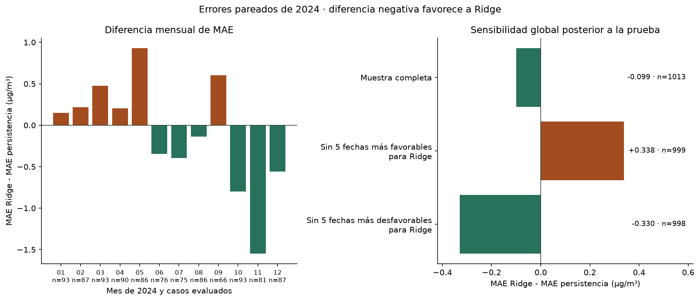

# Errores de regresión por estación, mes y nivel

## Muestra y método

La auditoría describe las predicciones ya guardadas de Ridge y persistencia en 2024. Empareja las 1.013 observaciones por estación y fecha objetivo y comprueba que compartan observado, nombre y claves. Recalcula los errores desde las predicciones y el observado.

Se informa MAE, RMSE y sesgo por estación, mes y nivel observado. La diferencia de MAE se define como MAE de Ridge menos MAE de persistencia. Una diferencia negativa favorece a Ridge. El nivel elevado conserva el umbral fijado de PM10 estrictamente superior a 27 µg/m³.

El análisis es descriptivo y posterior a la prueba. Sus filtros utilizan el observado para localizar errores y el resultado principal sigue siendo el de la muestra completa. Los modelos, las predicciones y sus protocolos se conservan. El número de cinco fechas de la sensibilidad se eligió para inspeccionar la influencia de un conjunto pequeño y se registra como parámetro.

## Diferencias entre estaciones y niveles

| Estación o nivel | Casos | MAE Ridge | MAE persistencia | Diferencia |
| --- | ---: | ---: | ---: | ---: |
| Todas las estaciones y niveles | 1.013 | 5,958 | 6,058 | −0,099 |
| Tres Olivos | 329 | 7,029 | 7,501 | −0,472 |
| Majadahonda | 335 | 5,408 | 5,318 | +0,090 |
| San Martín de Valdeiglesias | 349 | 5,477 | 5,407 | +0,070 |
| PM10 hasta 27 µg/m³, todas las estaciones | 906 | 4,351 | 4,617 | −0,266 |
| PM10 mayor de 27 µg/m³, todas las estaciones | 107 | 19,562 | 18,252 | +1,310 |

Las métricas están expresadas en µg/m³. La ventaja global de Ridge se concentra en Tres Olivos. En los días elevados, Ridge tiene mayor MAE en las tres estaciones. El sesgo de Ridge en esos días es negativo en las tres y alcanza −22,319 µg/m³ en Majadahonda, donde hay 22 casos elevados.

Estos grupos tienen tamaños distintos y corresponden a las fechas evaluables. La comparación entre estaciones necesita considerar esos denominadores y la diferente distribución del observado.

## Variación mensual

Al agrupar las tres estaciones, Ridge obtiene menor MAE en seis de los doce meses. Las diferencias más favorables son noviembre, con −1,547 µg/m³ y 81 casos, y octubre, con −0,798 y 93 casos. La diferencia más desfavorable es mayo, con +0,930 y 86 casos.

La tabla interactiva de React permite combinar estación y nivel. Los meses sin casos evaluables se muestran con cero casos y métricas ausentes. El desglose permite localizar periodos y preparar hipótesis para otra evaluación. Un único año y grupos pequeños requieren cautela al atribuir el patrón a una estación del año.

## Influencia de fechas concretas

Para cada fecha se suma el error absoluto de persistencia menos el de Ridge en las estaciones evaluadas. Una suma positiva indica una contribución favorable a Ridge. Se ordenan las fechas por esa contribución y se vuelve a calcular la comparación retirando todas las observaciones de cinco fechas del extremo favorable o del desfavorable.

| Escenario global | Casos restantes | MAE Ridge | MAE persistencia | Diferencia |
| --- | ---: | ---: | ---: | ---: |
| Muestra completa | 1.013 | 5,958 | 6,058 | −0,099 |
| Retirar las cinco fechas más favorables para Ridge | 999 | 5,775 | 5,437 | +0,338 |
| Retirar las cinco fechas más desfavorables para Ridge | 998 | 5,456 | 5,786 | −0,330 |

Las fechas más favorables son el 1 de noviembre, 21 de marzo, 7 de octubre, 8 de junio y 8 de abril de 2024. Su retirada elimina 14 observaciones, porque las tres estaciones tienen diferente cobertura.

Las fechas más desfavorables son el 31 de octubre, 20 y 23 de marzo, 7 de abril y 22 de marzo. Su retirada elimina 15 observaciones. Los empates se resuelven conservando el orden cronológico.

La inversión de la diferencia al retirar las fechas más favorables indica sensibilidad de la mejora global a unas pocas fechas. La selección se hizo con los errores de prueba y produce escenarios extremos por construcción. Esta sensibilidad sirve para estudiar concentración del error. La [estimación posterior de incertidumbre](36_incertidumbre_pm10.md) utiliza bloques temporales que mantienen juntas las estaciones de cada fecha.

El 31 de octubre concentra los tres mayores errores de Ridge, uno en cada estación. En Tres Olivos su error absoluto alcanza 110,274 µg/m³. El 1 de noviembre, tras el pico, se encuentra entre las fechas más favorables a Ridge frente a persistencia. Ambas observaciones ayudan a entender el distinto comportamiento durante la subida y el descenso.

## Consulta, reproducción y evidencias

La pestaña Gráficos incluye filtros por estación y nivel, diferencias mensuales y la sensibilidad global. El filtro de esa tabla mensual afecta únicamente a su sección. La sensibilidad muestra siempre las tres estaciones y las fechas retiradas.

Desde la raíz del proyecto, ejecutar

~~~powershell
.\.venv\Scripts\python.exe -m pm10_data.pipelines.audit_pm10_errors
~~~

El [pipeline](../pm10_data/pipelines/audit_pm10_errors.py) reutiliza las funciones de [evaluación pareada](../pm10_data/evaluation/pm10_errors.py). Genera los [grupos completos](../output/pm10_error_analysis/grupos.csv), la [contribución por fecha](../output/pm10_error_analysis/contribucion_por_fecha.csv), la [sensibilidad](../output/pm10_error_analysis/sensibilidad_fechas.csv), los [diez mayores errores](../output/pm10_error_analysis/mayores_errores_ridge.csv), los [datos para la API](../output/pm10_error_analysis/analisis.json) y las [huellas y configuración](../output/pm10_error_analysis/configuracion.json).

Las pruebas comprueban métricas y particiones, retirada de fechas completas entre estaciones y rechazo de claves duplicadas, muestras incompatibles o valores no finitos. Las cifras agregadas se contrastan además con las métricas originales de 2024.

La figura se regenera con el [script de gráficos](../scripts/plot_pm10_errors.py), que utiliza las dependencias del notebook

~~~powershell
.\.venv\Scripts\python.exe scripts/plot_pm10_errors.py
~~~
