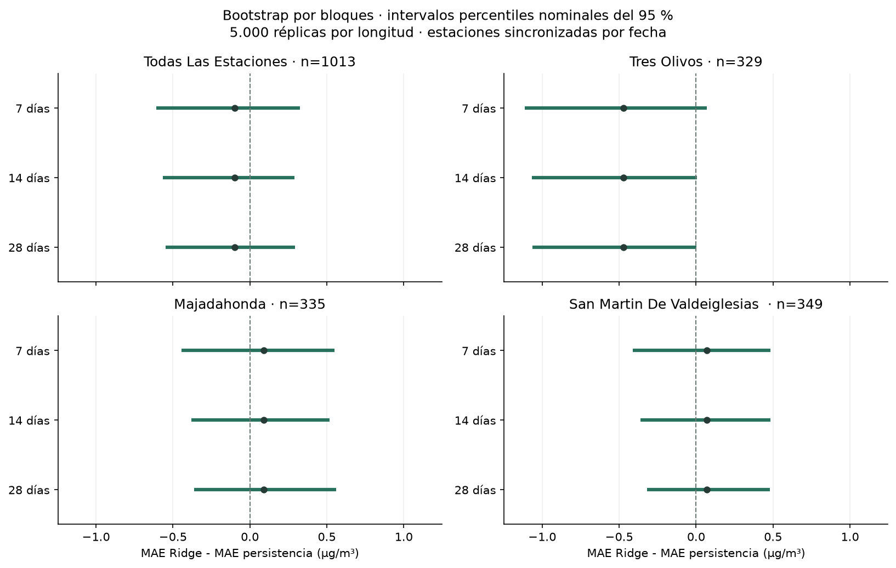

# Incertidumbre de la diferencia de MAE

## Pregunta y estimación

La diferencia observada de MAE entre Ridge y persistencia en las 1.013 observaciones evaluadas de 2024 es −0,0994 µg/m³. Una diferencia negativa favorece a Ridge. La [auditoría de errores](35_analisis_errores_pm10.md) mostró que la comparación cambia al retirar algunas fechas influyentes.

Se estima ahora la variabilidad de esa diferencia mediante un bootstrap pareado por bloques móviles de fechas. El análisis mantiene fijos los modelos y sus predicciones. Su alcance es un diagnóstico posterior a la prueba, condicionado a los errores observados en 2024 y a las estaciones elegidas.

Los bloques consecutivos permiten conservar la dependencia temporal dentro de cada bloque. El remuestreo por bloques para series dependientes y sus condiciones se describe en la sección 3.3 de Léger, Politis y Romano. [Bootstrap Technology and Applications, 1992](https://www.stat.cmu.edu/technometrics/90-00/vol-34-04/v3404378.pdf)

## Procedimiento reproducible

1. Emparejar Ridge y persistencia por estación y fecha objetivo y recalcular ambos errores absolutos.
2. Construir el calendario completo de 366 fechas de 2024. En cada fecha conservar la suma de diferencias de errores absolutos y el número de casos evaluados. Una fecha sin casos recibe suma y recuento cero.
3. Formar todos los bloques solapados de longitud L que caben en el calendario. Cada bloque mantiene el orden de sus fechas y termina dentro de 2024.
4. Muestrear inicios de bloque con reemplazo y concatenar suficientes bloques hasta disponer de 366 fechas. Truncar el último bloque al alcanzar ese tamaño.
5. Aplicar la misma secuencia de fechas a las tres estaciones y a ambos modelos. Calcular la suma de diferencias dividida por el número de observaciones evaluables remuestreadas.
6. Repetir 5.000 veces por longitud. Tomar los percentiles 2,5 y 97,5 de las diferencias para el intervalo nominal del 95 %.

Se fija una longitud principal de **14 días** para conservar dependencia dentro de periodos de aproximadamente dos semanas y se exploran **7 y 28 días** como sensibilidad. Estas longitudes son decisiones de este diagnóstico y quedan registradas antes de ejecutar el cálculo. La semilla es **20261119**, combinada con la longitud de bloque mediante SeedSequence de NumPy.

Los huecos permanecen en el calendario y las estaciones de una misma fecha se remuestrean juntas. El denominador cambia entre réplicas cuando se repiten fechas con distinta cobertura. El estimador pondera por observaciones de estación y fecha, de forma coherente con el MAE global original. Los bloques se construyen sin unir diciembre con enero.

## Resultados globales

| Bloque | Diferencia observada | Límite inferior | Límite superior | Incluye cero |
| --- | ---: | ---: | ---: | --- |
| 7 días | −0,099 | −0,609 | +0,326 | Sí |
| 14 días, principal | −0,099 | −0,565 | +0,288 | Sí |
| 28 días | −0,099 | −0,546 | +0,294 | Sí |

Las cifras están expresadas en µg/m³. Las tres longitudes dejan abierta la dirección de la diferencia. El punto observado favorece a Ridge, mientras los intervalos abarcan valores que favorecen a cualquiera de los dos métodos. Con este remuestreo y esta muestra, la mejora del MAE global permanece incierta.

## Resultados por estación

| Estación | Casos | Diferencia observada | Intervalo principal de 14 días |
| --- | ---: | ---: | --- |
| Tres Olivos | 329 | −0,472 | [−1,068; +0,006] |
| Majadahonda | 335 | +0,090 | [−0,379; +0,517] |
| San Martín de Valdeiglesias | 349 | +0,070 | [−0,363; +0,482] |

Todos los intervalos por estación y longitud incluyen cero. En Tres Olivos, los límites superiores de 14 y 28 días quedan próximos a cero. Esa proximidad requiere cautela por el error Monte Carlo y las decisiones de remuestreo.

## Alcance de la interpretación

El intervalo corresponde a la diferencia media de errores de dos modelos congelados. La incertidumbre del ajuste de modelos, la selección previa de estaciones y la elección de variables requerirían una evaluación que incorporase esas etapas.

El bootstrap por bloques se apoya en condiciones de dependencia y estabilidad de la serie. Un único año presenta estacionalidad y episodios extremos que pueden influir en la distribución remuestreada. La concatenación conserva dependencias dentro de bloque y cambia las relaciones entre bloques. En la variante utilizada, las fechas de los extremos del año tienen menor probabilidad de inclusión que las interiores. La sensibilidad a tres longitudes ayuda a describir el comportamiento del procedimiento.

El nivel del 95 % es nominal y la cobertura real en este problema no se ha validado con simulaciones o nuevos años. El diagnóstico tampoco incorpora la incertidumbre por fechas excluidas debido a datos incompletos. El calendario y su patrón de ausencias se remuestrean tal como fueron observados.

Los resultados por estación y longitud son exploratorios y deben leerse conjuntamente. El estudio mantiene el resultado principal sobre todas las filas y evita elegir un modelo nuevo a partir de estos intervalos. Para una afirmación de utilidad sostenida, el siguiente contraste sería sobre otro periodo con reglas y disponibilidad fijadas previamente.

## Consulta y ejecución

En React, la pestaña Gráficos permite elegir una estación y consultar los intervalos de 7, 14 y 28 días. La línea representa el intervalo, el punto marca la diferencia observada y la referencia vertical señala cero.

Desde la raíz

~~~powershell
.\.venv\Scripts\python.exe -m tfm_data.pipelines.bootstrap_pm10_errors
~~~

El [pipeline](../tfm_data/pipelines/bootstrap_pm10_errors.py) utiliza las [funciones de remuestreo](../tfm_data/evaluation/pm10_bootstrap.py) y genera los [intervalos](../output/pm10_bootstrap/intervalos.csv), las [60.000 réplicas de grupo y longitud](../output/pm10_bootstrap/replicas.csv.gz), la [configuración y huella de entrada](../output/pm10_bootstrap/configuracion.json) y los [datos de la API](../output/pm10_bootstrap/analisis.json).

Para regenerar la figura, con las dependencias del notebook instaladas

~~~powershell
.\.venv\Scripts\python.exe scripts/plot_pm10_bootstrap.py
~~~

Las pruebas comprueban consecutividad y límites de los bloques, repetición con la misma semilla, conservación de huecos, ponderación por recuentos y sincronización entre estaciones.
